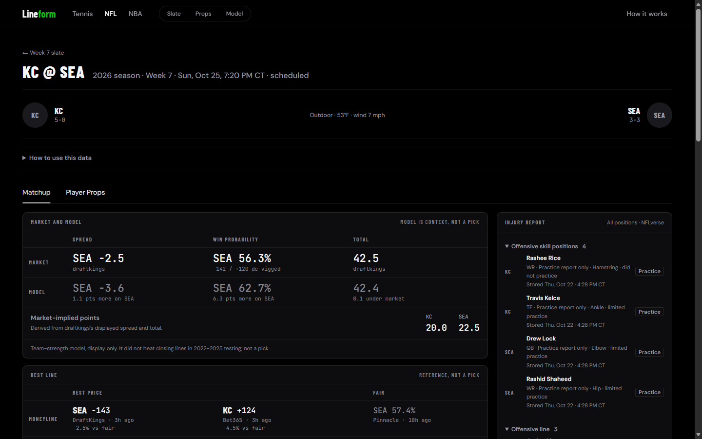
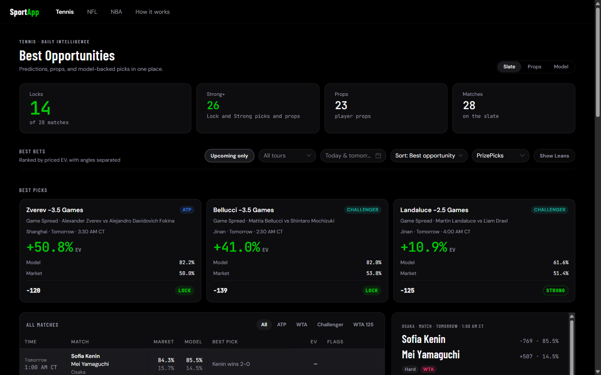
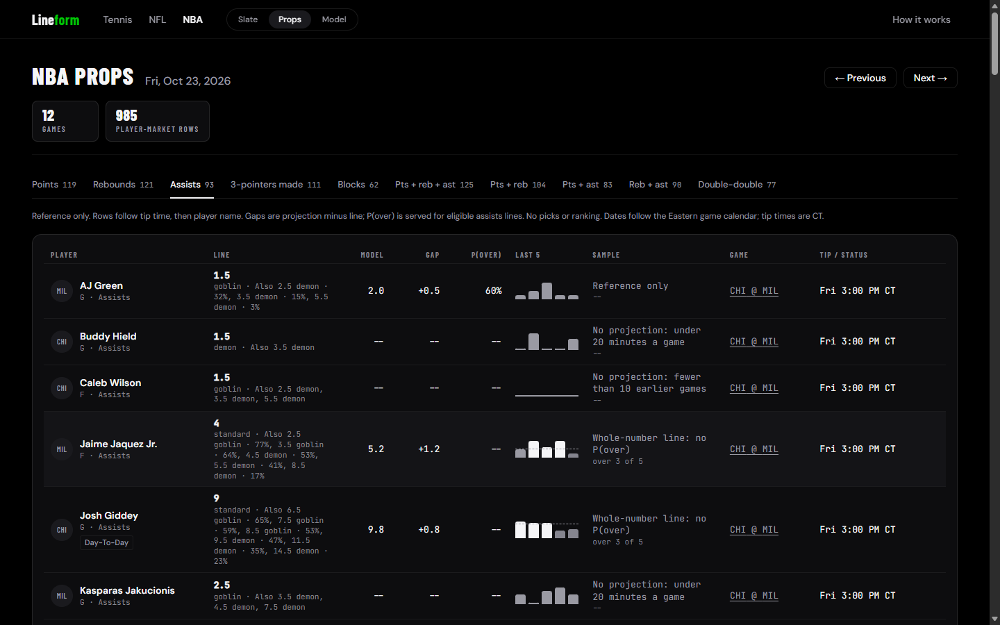
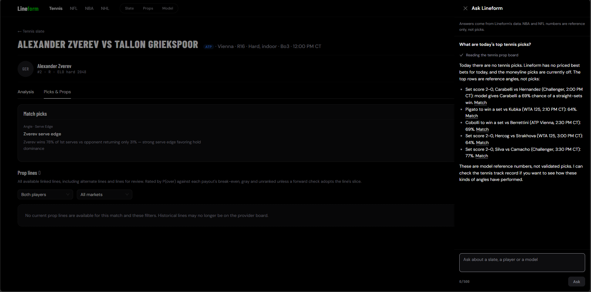
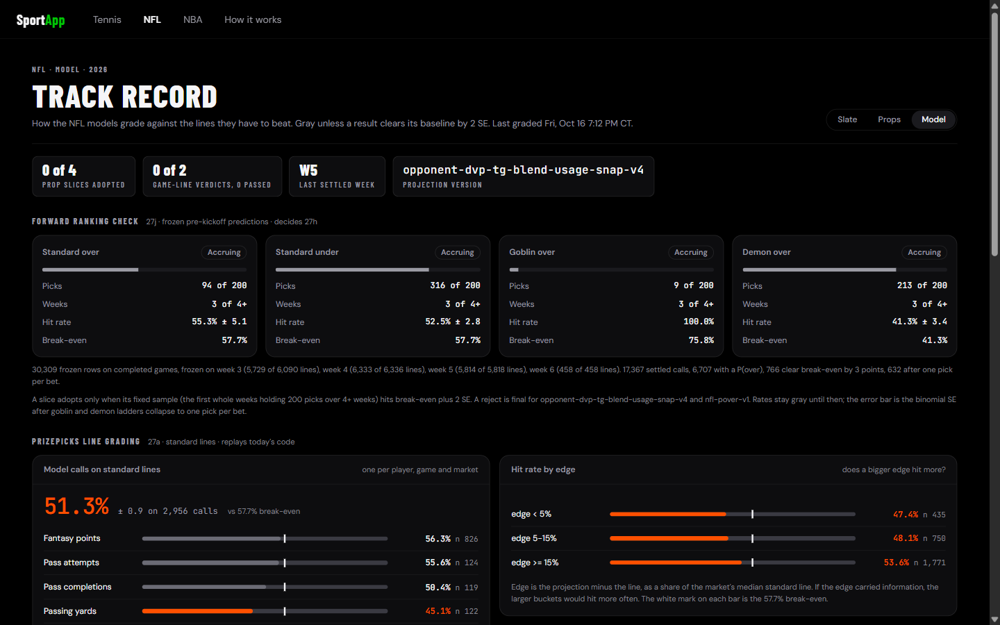

# Lineform

[](https://github.com/Dayshawn21/Sports-Baseline/actions/workflows/verify.yml)

A sports betting research app for tennis, NFL, NBA and NHL. It ingests
matches, odds, player stats and prop lines on a schedule, and builds model
projections. It then grades those projections against the betting market,
so an edge is measured rather than assumed. An AI assistant, Ask Lineform,
answers questions about that data in plain English.

**Live demo:** https://sportapp-web-7v3r.onrender.com
(read-only; anyone can browse every page)
**How it works:** https://sportapp-web-7v3r.onrender.com/#/how-it-works



## What it shows

| Sport | Pages | What is a pick today |
|---|---|---|
| Tennis | Daily slate, prop board, match (research and picks tabs), player, model track record | Derived game-spread and serve-edge picks. PrizePicks lines stay gray and unranked until a forward check adopts their slice (none has yet). Moneyline picks are off (see below). |
| NFL | Game-first slate, prop board, game (matchups, usage, injuries, best line), player, model track record | None. Prop edges, the Rec Targets projection, the game-line model and the best-line view are reference only, shown in gray. |
| NBA | Slate, prop board, game (injuries, team stats), model track record | None. A reference projection with P(over) for assists only, shown in gray. |
| NHL | Slate, game (market, line movement, injuries, starting goalies) | None. Odds and prop lines only; no model yet. |





The tennis slate ranks its remaining picks by modelled EV. A large EV figure
there is the model's own estimate, not a validated edge. Tennis prop lines
no longer carry confidence tiers: the old tier record lost at every tier, so
it is kept as history, and each line is now graded forward by P(over) slice
under a rule written down before the data is read.

## Ask Lineform



A chat panel in the top bar answers questions such as "what are tonight's
NBA props?" or "how has the NFL model done?". It is built on the Claude API
with six tools that call the same services the pages use, so the assistant
and a page cannot describe one line differently.

- **Numbers come only from tool results.** Every answer links to the
  Lineform page behind it, and reference-only or rejected signals are never
  presented as picks. Asked for picks on a day with none, it says so.
- **The tool loop is written by hand**, not with a framework. It handles
  parallel tool calls, tool errors, unknown tools and a five-round limit,
  and is tested against a mocked client. Answers stream over Server-Sent
  Events.
- **Cost is capped before Claude is called:** a per-visitor daily question
  limit, a global daily spend cap and a token cap per answer, with each
  request's tokens and estimated cost logged. A monthly limit in the
  Anthropic Console is the hard stop.
- **An eval script** (kept out of CI because it spends money) runs 30
  questions, each checking the tools called, the facts required and that
  every number in the answer appears in a tool result. A full run costs
  about two cents.

## What I found

The interesting part of this project is what the testing showed, not the
models themselves.

- **Every signal had to pass a backtest first.** Each new signal had to beat
  the market or the production model on a held-out season, under an
  adoption rule written down before the data was read. Most failed, and the
  app says so.
- **Tennis.** On the 2023 to 2025 holdout (12,068 ATP and WTA matches), the
  Pinnacle closing line beat computed ELO and the original hand-set blend on
  log loss. A blend fitted on 2022 matched the close (+0.0002 +/- 0.0004), but
  betting its larger disagreements still lost money. So the served tennis
  model is now anchored to the market, and moneyline picks are switched off.
  A separate WTA 125 blend failed to beat the pooled one on 970 fresh 2026
  matches, so it was dropped. An in-house ELO rebuilt from TennisMyLife
  results is being compared forward against the current source, under a
  rule fixed before the first match, before it can replace it.
- **NFL game lines.** Team ELO, a scoring rating, weather, rest and
  play-by-play efficiency were each tested against closing lines on
  2022 to 2025. None beat the close, so the model is shown as context, never
  as a pick.
- **NFL props.** The first grading of the PrizePicks prop model (2026-09-26)
  hit 48.1% of 750 calls, against a 57.7% per-pick break-even. Prop edges
  have been gray since. Frozen pre-kickoff predictions are graded weekly
  under a rule fixed before any week was played. Through week 6 of 2026,
  two of its four slices (standard unders and demon overs) have been
  rejected under that rule; the other two are still accruing. A new Rec Targets
  projection is served as a reference, but its over probability failed its
  one 2025 calibration check, so it stays hidden.
- **NBA over probabilities.** The first method passed the calibration rule
  for assists only and hid the other eight markets. A second method, with
  its rules committed to git before any fit, passes six of those eight on
  2024-25. That is development evidence only: the probabilities stay hidden
  until a single check on the first four weeks of the 2026-27 season.
- **Color is a claim.** Green means a result beat its baseline by more than
  two standard errors. Anything still accruing or unvalidated stays gray.

The live track records:
[tennis](https://sportapp-web-7v3r.onrender.com/#/tennis/model),
[NFL](https://sportapp-web-7v3r.onrender.com/#/nfl/model),
[NBA](https://sportapp-web-7v3r.onrender.com/#/nba/model).



## Architecture

- **API** (`api/`): FastAPI on Python 3.11, async SQLAlchemy over Postgres.
  The code is layered: thin routers, services for orchestration, pure
  functions in `app/core/` with no I/O, and all SQL in `app/repositories/`.
- **Web** (`web/`): a React single-page app that only talks to the API.
- **Ask Lineform:** `POST /ask` in the API, streaming over SSE. The tools
  live in `app/services/ask/` and the cost math in `app/core/ask_cost.py`.
  It is off unless `ASK_ENABLED` is set.
- **Database:** PostgreSQL on Neon, with 50 Alembic migrations.
- **Ingest:** standalone `python -m app.ingest.<name>` jobs, scheduled in
  GitHub Actions. The hosted API runs no cron jobs.
- **Hosting:** Render, a Python web service and a static site, defined in
  [`render.yaml`](render.yaml). Reports too heavy to build inside the
  512 MB instance are precomputed by the scheduled jobs and served from
  the database. That covers the NFL slate (up to 18 MB of JSON a week) and
  the NFL prop-line grading.
- **CI:** [`verify.yml`](.github/workflows/verify.yml) runs the typecheck,
  both test suites and the build, plus a pinned gitleaks secret scan, on
  every push and pull request.

## Stack

- **Backend:** FastAPI, SQLAlchemy 2 (async, psycopg 3), Alembic,
  Pydantic 2, LightGBM, scikit-learn.
- **AI:** the Anthropic Messages API (Claude Haiku) for Ask Lineform.
- **Frontend:** React 19, Vite, TypeScript (strict), Ant Design 5,
  Tailwind CSS v4, TanStack Query.
- **Tests:** pytest (about 4,800 tests) and Vitest (about 800).
- **Data:**
  - **Tennis:** livetennisapi, TennisAbstract, TennisMyLife, Odds-API.io,
    PrizePicks.
  - **NFL:** NFLverse, The Odds API, Odds-API.io, PrizePicks.
  - **NBA:** hoopR's ESPN releases, ESPN's injury feed, The Odds API,
    PrizePicks.
  - **NHL:** the NHL API, ESPN's injury and goalie feed, Odds-API.io,
    PrizePicks.

## Running locally

You need Python 3.11, Node 20.19 or newer, and PostgreSQL 15 or newer. The
pages fill only once the ingest jobs have run, and those need the provider
API keys listed in `api/.env.example`.

**API**

```bash
cd api
python -m venv .venv
.venv/bin/pip install -r requirements.txt   # Windows: .venv\Scripts\pip
cp .env.example app/.env                    # then set DATABASE_URL
```

Migrations need an `alembic.ini`, which is not tracked. Copy
`.claude/skills/neon-migrate/alembic.ini.template` to `api/alembic.ini`, set
`script_location = app/db/migrations`, then run `alembic upgrade head`
from `api/`.

```bash
uvicorn app.main:app --reload               # http://127.0.0.1:8000
```

On Windows, psycopg's async driver needs the selector event loop, so start
the API like this instead:

```bash
python -c "import asyncio, sys, uvicorn; sys.path.insert(0, '.'); asyncio.set_event_loop_policy(asyncio.WindowsSelectorEventLoopPolicy()); uvicorn.run('app.main:app', port=8000, loop='none')"
```

**Web**

```bash
cd web
npm ci
npm run dev                                 # http://localhost:3001, proxies /api to the API
```

**Checks** (the same command CI runs, from the repo root, with the API venv
active):

```bash
npm --prefix web run verify && cd api && python -m pytest
```

## Repo map

| Path | What is there |
|---|---|
| `api/app/routers`, `services`, `core`, `repositories` | The API layers described above |
| `api/app/ingest` | Scheduled data jobs |
| `api/app/backtest` | The holdout tests and forward grading reports |
| `web/src` | Pages, hooks, typed API client, pure display helpers |
| `.github/workflows` | CI and the ingest schedules |
| `blueprint/` | The AI-assisted build workflow. It holds the plan, and a spec for every shipped feature with its test evidence. |

## About this repo

This is a personal research project, not betting advice.

The code is shared for review; all rights reserved.

The repository starts from a clean snapshot. Earlier development history is
kept privately.
